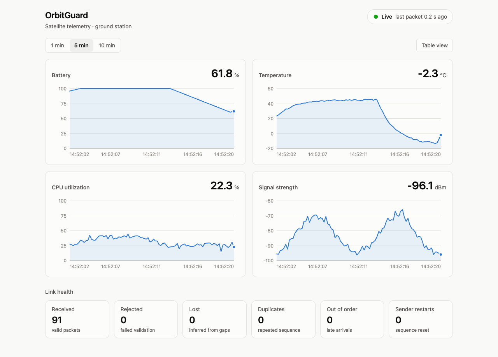
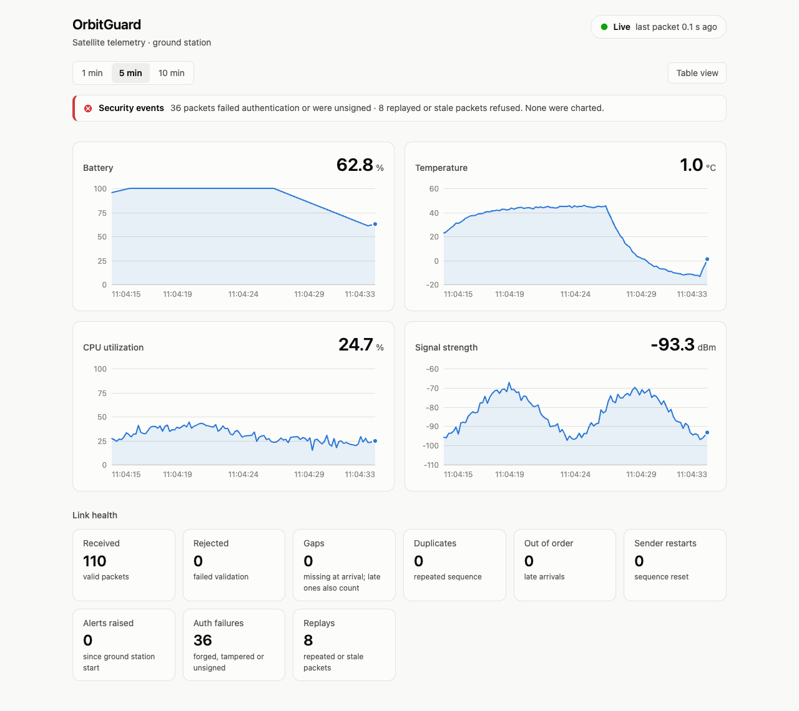
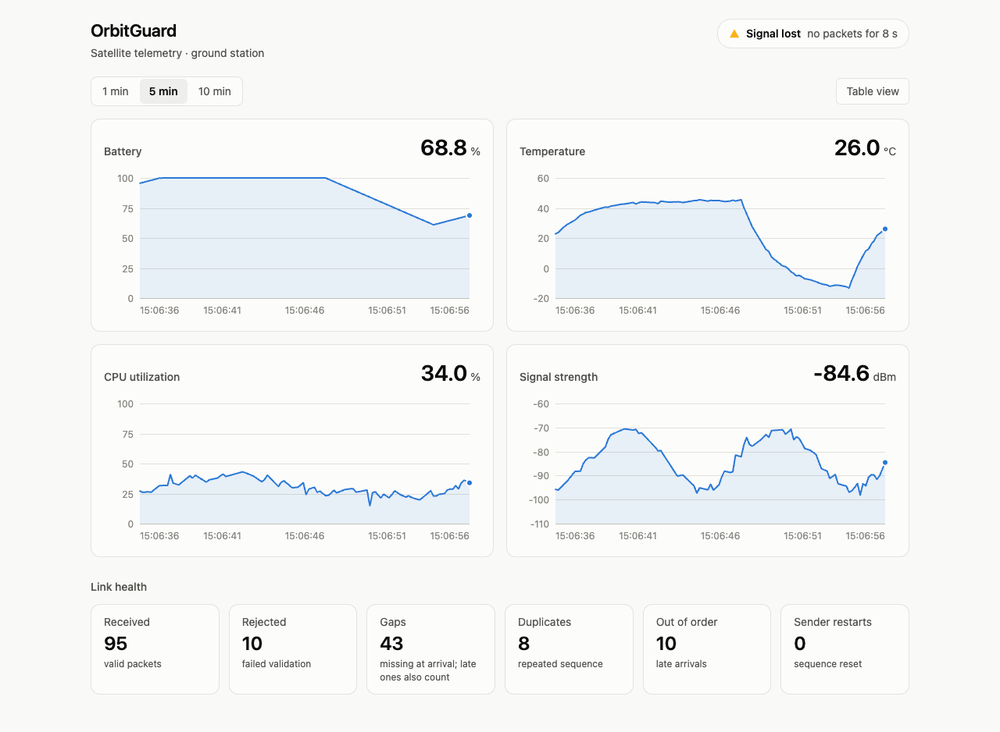
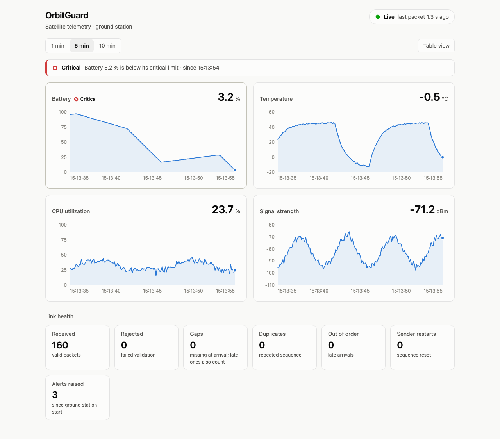
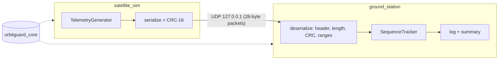

# OrbitGuard

[](https://github.com/samyukthasyamsundar/OrbitGuard/actions/workflows/ci.yml)
[](https://github.com/samyukthasyamsundar/OrbitGuard/actions/workflows/security.yml)

A satellite telemetry link in C++17, built to practise **securing and testing a system that
parses untrusted input**. A simulated satellite sends telemetry over UDP to a ground station,
which validates it, authenticates it, charts it on a live dashboard, and can be attacked.



## What makes it interesting

- **An attack tool that found a real flaw in my own design.** `rogue_sender` forges, tampers,
  replays and floods a live ground station. Running it showed that *one* genuinely signed packet
  with a huge counter made the replay window reject every later real packet (40 of 40 lost). I
  fixed it by bounding counter jumps and re-ran the attack to confirm. A related weakness (a
  poisoned *first* packet) can't be closed inside the protocol, so it is documented, not hidden.
- **A threat model tied to evidence.** [docs/THREAT_MODEL.md](docs/THREAT_MODEL.md) lists ten
  threats, each pointing at the test or experiment that backs it, and a longer list of what is
  **not** protected.
- **Tests that were themselves tested.** The security tests were validated by *mutation*: I
  deliberately broke the code (removed the tag check, half-checked it, left the counter out of
  the tag, advanced the replay window early, an off-by-one) and confirmed a test failed each
  time. That process also exposed a gap in my own tests (an HMAC key-length boundary), now closed.
- **Fuzzing and static analysis in CI.** Four untrusted-input parsers are fuzzed (coverage-guided
  with libFuzzer on Linux, plus a portable seeded driver), alongside CodeQL, cppcheck, and
  AddressSanitizer / UBSan / ThreadSanitizer builds on gcc and clang.
- **Defence in depth on the supply chain too.** The GoogleTest download is pinned to a SHA-256
  (verified: a wrong hash aborts the build), workflow tokens are read-only, and binaries are built
  with a stack protector, `_FORTIFY_SOURCE` and PIE.
- **Honest limits.** Every feature lists what it does not do. See [Known limitations](#known-limitations).

By the numbers: 173 tests, about 2,800 lines of source and 2,000 of tests, 4 CI platforms and
3 security scans, all passing.

## Contents

[Build and test](#build-and-test) · [Run](#run) · [Security](#security) ·
[Degraded links](#testing-a-degraded-link) · [Alerts](#alerts) · [Record and replay](#record-and-replay) ·
[Architecture](#architecture) · [Wire format](#wire-format-v1-28-bytes-big-endian) ·
[Engineering decisions](#engineering-decisions) · [Known limitations](#known-limitations)

## Build and test

Requirements: a C++17 compiler (clang or gcc), CMake >= 3.16, git, and network access on
the first configure (GoogleTest v1.14.0 is fetched with `FetchContent`). POSIX sockets are
used, so this targets macOS and Linux.

```sh
cmake -S . -B build -DCMAKE_BUILD_TYPE=Release
cmake --build build -j
ctest --test-dir build --output-on-failure
```

Optional sanitizer build:

```sh
cmake -S . -B build-asan -DCMAKE_BUILD_TYPE=Debug \
      -DCMAKE_CXX_FLAGS="-fsanitize=address,undefined -fno-omit-frame-pointer"
cmake --build build-asan -j && ./build-asan/orbitguard_tests
```

## Run

Use two terminals (start the ground station first):

```sh
./build/ground_station --port 5000
./build/satellite_sim  --port 5000 --rate-hz 2
```

Then open http://127.0.0.1:8080/ for the live dashboard (`--http-port N` changes the
port, `--no-dashboard` turns it off). Both programs accept `--help`. The simulator takes `--count N` and `--seed N` (reproducible
telemetry); the ground station takes `--max-packets N` and `--idle-timeout-s N` so it can
be scripted. Ctrl-C stops either one cleanly, and the ground station prints a summary
(valid, rejected, lost, duplicate and out-of-order counts).

## Security

By default the link has only a CRC, which catches accidents but not an attacker. With a shared
key, every packet is authenticated (HMAC-SHA256, 128-bit tag) and protected against replay:

```sh
python3 -c "import secrets; print(secrets.token_hex(32))" > key.hex && chmod 600 key.hex
./build/ground_station --port 5000 --key-file key.hex     # now REQUIRES signed packets
./build/satellite_sim  --port 5000 --key-file key.hex
```

The ground station then refuses unsigned, forged, tampered and replayed packets, counts each as a
security event, and shows them on the dashboard without charting them. Keys are read from a file
that must be mode 600 (never from the command line, where they would leak).

`rogue_sender` attacks a local ground station so you can watch the defences work:

```sh
./build/rogue_sender --attack forge|wrongkey|tamper|replay|flood --port 5000 --key-file key.hex
```



**Read [docs/THREAT_MODEL.md](docs/THREAT_MODEL.md)** for what is and is not protected. In short:
it defeats forgery, tampering, replay and downgrade by someone without the key; it does **not**
give confidentiality, protect a stolen key, or stop a flood from crowding out real packets (measured,
not solved; see the threat model's DoS section for what was tried and what did not help).

Other security work in the repo:
- **Fuzzing** of the packet decoder, authenticated opener, HTTP parser and recording reader.
  `fuzz_driver` runs anywhere; coverage-guided libFuzzer targets run in CI on Linux.
- **CI scanning:** CodeQL, cppcheck, and sanitizer builds. Workflow tokens are read-only.
- **Supply chain:** the GoogleTest download is pinned to a SHA-256 (a wrong hash fails the build).
- **Hardening flags:** stack protector, `_FORTIFY_SOURCE`, PIE.
- **Mutation-checked tests:** the security tests were validated by deliberately breaking the code.

> The SHA-256 and HMAC here are implemented from the standards and tested against the official
> vectors, but they are a learning implementation. Use a vetted library for anything real.

## Testing a degraded link

`satellite_sim` can impair its own link so you can watch the ground station cope. Each
flag is a probability between 0 and 1, and `--fault-seed` makes a run reproducible:

```sh
./build/ground_station --port 5000
./build/satellite_sim --port 5000 --rate-hz 5 --drop 0.1 --corrupt 0.1 --duplicate 0.1 --reorder 0.1
```

| Flag | Effect | What the ground station does |
|------|--------|------------------------------|
| `--drop` | packet never sent | shows as a gap in the sequence |
| `--corrupt` | one bit flipped, or the datagram truncated | rejected (CRC, length or header check), counted under Rejected |
| `--duplicate` | packet sent twice | second copy counted as a duplicate, not charted twice |
| `--reorder` | packet delayed behind the next one | counted as out of order, not charted |



The simulator prints how many faults it injected, so the two sides can be reconciled.
Faults are applied after encoding, on the wire bytes, so they exercise the real
validation path rather than a mock.

## Alerts

The ground station evaluates every charted sample against warning and critical limits and
shows active alerts as a banner plus a badge on the affected chart. Each alert uses an
icon and a word as well as color.

| Metric | Warning | Critical |
|--------|---------|----------|
| Battery | below 40 % | below 20 % |
| Temperature | above 60 C or below -25 C | above 80 C or below -40 C |
| CPU | above 85 % | above 95 % |
| Signal | below -105 dBm | below -115 dBm |

An alert clears only after the value recovers past its limit by a margin (3 units, 2 dBm
for signal), so a reading hovering at a limit does not flap. Duplicate and late packets
are never evaluated, so a repeated packet cannot clear or raise an alert.

Nominal flight stays well inside these limits, so `satellite_sim` can inject an anomaly:

```sh
./build/satellite_sim --port 5000 --rate-hz 8 --time-scale 480 --scenario battery-drain
```

Scenarios: `battery-drain`, `overheat`, `cpu-spike`, `signal-loss` (default `nominal`).



## Record and replay

`ground_station --record FILE` saves every datagram it receives, **including invalid ones**,
with its arrival time. `telemetry_replay` sends a recording back out with the original
pacing, so a degraded-link session can be reproduced exactly and inspected on the dashboard.

```sh
./build/ground_station --port 5000 --record session.ogrec
# ... later, into a fresh ground station:
./build/ground_station --port 5000
./build/telemetry_replay --file session.ogrec --port 5000 --speed 4
```

`--speed X` scales playback, and `--max-gap-ms N` (default 5000) shortens long pauses so a
gap in the recording cannot stall a replay.

A replay into a fresh ground station reproduces the original counters exactly. In one
checked run of 304 recorded datagrams from a link with all four faults enabled, both
stations reported `valid=275 rejected=29 lost=72 duplicates=28 out_of_order=20`.

The file format is documented in `include/orbitguard/recording.hpp` (an 8-byte header,
then `rx_time_ms`, a length and the raw bytes per datagram). Recordings are treated as
untrusted input: record lengths are bounded before any allocation, a file cut off partway
through a record (for example after a crash) replays everything before it and reports the
truncation, and `--record` refuses to overwrite an existing file.

## Architecture



## Sample output

Ground station, after a garbage datagram and five telemetry packets:

```
ground_station: listening on 127.0.0.1:5055
recv seq=0 ts=1794330788295 batt=95.04% temp=20.81C cpu=26.59% sig=-95.83dBm
recv seq=1 ts=1794330788346 batt=95.07% temp=20.00C cpu=24.71% sig=-96.37dBm
recv seq=2 ts=1794330788398 batt=95.11% temp=20.29C cpu=22.34% sig=-94.41dBm
recv seq=3 ts=1794330788450 batt=95.14% temp=20.44C cpu=23.88% sig=-94.96dBm
recv seq=4 ts=1794330788498 batt=95.18% temp=20.60C cpu=22.90% sig=-94.66dBm
summary: valid=5 rejected=1 lost=0 duplicates=0 out_of_order=0
```

The rejected datagram is reported on stderr: `rejected packet (7 bytes): packet too short`.

## Layout

| Path | Responsibility |
|------|----------------|
| `include/orbitguard/telemetry.hpp` | In-memory `Telemetry` struct and physical limits (never sent raw) |
| `byte_io.hpp` | Big-endian `ByteWriter` / bounds-checked `ByteReader` |
| `crc16.hpp`, `src/crc16.cpp` | CRC-16/CCITT-FALSE |
| `packet_codec.*` | Wire format, `serialize`, `deserialize`, `CodecError` |
| `telemetry_generator.*` | Seeded orbit/eclipse model that produces samples |
| `sha256.*`, `secure_packet.*` | SHA-256/HMAC, the authenticated packet format, replay window, key ring |
| `alerts.*` | Threshold alerts with hysteresis |
| `recording.*`, `replay.*` | Capture file format with a bounds-checked reader, and the paced replayer |
| `fault_injector.*` | Seeded drop, corrupt, duplicate and reorder of wire bytes |
| `sequence_tracker.*` | Loss, duplicate and reorder accounting (wrap-safe) |
| `telemetry_store.*` | Thread-safe sample history and link counters shared by the receiver and the web server |
| `http_server.*`, `dashboard_routes.*`, `snapshot_json.*` | Minimal read-only localhost HTTP server, its routes, and the JSON API |
| `web/dashboard.html` | The dashboard: one self-contained page, embedded into the binary at build time |
| `udp_socket.*` | RAII POSIX UDP wrapper (with the HTTP server, the only platform-specific code) |
| `apps/` | `satellite_sim` and `ground_station` executables (thin `main`s) |
| `tests/` | GoogleTest unit and loopback integration tests |

`orbitguard_core` is a static library linked by both apps and the tests, so a future
dashboard can reuse it unchanged.

## Wire format (v1, 28 bytes, big-endian)

| Offset | Size | Field | Notes |
|-------:|-----:|-------|-------|
| 0 | 2 | magic | `0x4F47` ("OG") |
| 2 | 1 | version | 1 |
| 3 | 1 | type | 1 = telemetry |
| 4 | 2 | payload_length | 20 |
| 6 | 4 | sequence | u32 |
| 10 | 8 | timestamp_ms | u64, Unix epoch ms |
| 18 | 2 | battery | u16, 0.01 % |
| 20 | 2 | temperature | i16, 0.01 C |
| 22 | 2 | cpu | u16, 0.01 % |
| 24 | 2 | signal | i16, 0.01 dBm |
| 26 | 2 | crc16 | over bytes 0..25 |

## Engineering decisions

- **Explicit serialization, no struct copying.** `memcpy`-ing a struct leaks padding,
  host endianness and `sizeof(double)` onto the wire and is undefined to read back on a
  different compiler. Each field is written individually in network byte order, so the
  format is defined by the table above, not by the compiler.
- **Fixed-point on the wire.** Doubles become 16-bit integers in 0.01 units. That is
  compact, deterministic, and gives a hard range per field. Resolution is 0.01, so a
  round trip is accurate to +/-0.005.
- **Header, version and magic.** Lets the receiver reject foreign traffic immediately and
  leaves room to evolve the protocol. The version is checked before the layout is trusted.
- **CRC-16 verified before fields are trusted.** UDP's checksum is weak and optional on
  some paths. Tests flip every single bit of a packet and assert that each one is rejected.
- **Validate on both sides.** The encoder refuses NaN, infinity and out-of-range values
  (so the sender cannot emit a bad packet), and the decoder range-checks again even when
  the CRC is valid (so a buggy or hostile sender cannot inject nonsense).
- **Errors are values, not exceptions.** `Result<T, E>` (C++17 has no `std::expected`)
  makes every failure explicit at the call site. A malformed datagram is routine input
  for a receiver, so it is logged and counted, and the loop continues.
- **Bounds-checked reads.** `ByteReader` sets a sticky failure flag instead of reading
  past the buffer. The socket buffer is fixed-size, and oversized datagrams fail the
  exact-length check.
- **Sequence numbers with wrap-safe arithmetic.** UDP loses, duplicates and reorders.
  The tracker uses signed 32-bit modular difference, so it behaves correctly across the
  2^32 wrap.
- **Deterministic generator, injected time.** The model takes a seed and a caller-supplied
  timestamp, so tests are reproducible and independent of the wall clock.
- **Platform code isolated.** Only `udp_socket.cpp` touches POSIX. The protocol and
  simulation compile and test without networking.
- **Strict warnings.** `-Wall -Wextra -Wpedantic -Wconversion -Werror` (disable with
  `-DORBITGUARD_WERROR=OFF` if a new compiler adds warnings).

## Dashboard decisions

- **Embedded, dependency-free.** The page is a single HTML file compiled into
  `ground_station`, with no CDN, fonts or JS libraries, so it works offline and the binary
  does not depend on the working directory.
- **Polling JSON, not WebSockets.** The browser polls `GET /api/telemetry` once a second.
  It is simple, stateless, and trivially testable with `curl`; telemetry at 1 Hz does not
  need a push channel.
- **Localhost-only and read-only.** The server binds `127.0.0.1`, serves only `GET`/`HEAD`
  on three fixed routes (it never opens files, so there is no path traversal), caps the
  request head at 8 KiB, times out slow clients, and rejects any `Host` header that is not
  this server (DNS-rebinding defence). It sends a strict Content-Security-Policy and no
  CORS headers.
- **One writer, many readers.** The UDP loop writes into `TelemetryStore` under a mutex;
  HTTP threads only copy snapshots out. The suite also runs clean under ThreadSanitizer.
- **Restart-aware sequence tracking.** The sender timestamp tells a late packet from a
  restarted sender, so restarting `satellite_sim` is reported as a restart, not as
  thousands of lost packets.
- **Honest charting.** One chart per metric, since the units differ, so no dual axes.
  Status is shown with an icon and a label, never color alone. Every chart has hover and
  keyboard (arrow key) readouts and a table-view twin, and the page supports dark mode.

## Known limitations

- Loopback only, IPv4, single sender. The ground station does not authenticate the sender;
  the CRC detects corruption, not tampering.
- Restart detection assumes the sender timestamp does not go backwards within a session
  (a wall-clock step would look like out-of-order packets until it catches up).
- The tracker counts a gap as loss immediately, so a late-arriving packet is counted as
  both a gap and out-of-order. The dashboard labels this tile "Gaps" for that reason; with
  fault injection on, gaps exceed the number of packets actually dropped.
- No Windows support (POSIX sockets).
- The dashboard keeps the latest 600 samples in memory only; there is no persistence.
- Recordings keep only the raw datagram and arrival time; they do not store the satellite's
  link settings. Replay uses loopback UDP only.
- Alert limits are compiled in; there is no config file or command-line override yet.
- The dashboard JavaScript has no automated tests. It was checked by hand in a browser,
  and that found a real bug (the first metric's alerts were being dropped).
- The dashboard has no authentication; it relies on being bound to localhost.
- Authentication has no confidentiality, no per-device identity and no rate limiting; see the threat model.
- The counter is seeded from the wall clock; a satellite whose clock jumps backwards is refused.

## License

MIT, see [LICENSE](LICENSE).
