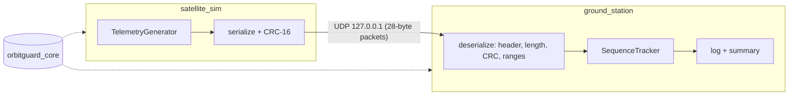

# OrbitGuard

[](https://github.com/samyukthasyamsundar/OrbitGuard/actions/workflows/ci.yml)

A satellite telemetry simulation written in C++17. A **satellite simulator** streams
telemetry over UDP to a separate **ground station** receiver on localhost. The point of
the project is the engineering around the link: an explicit wire protocol, validation,
and failure handling.

**Status: Phase 2.** Simulator, ground station, protocol, tests, and a live web dashboard.


## Build and test

Requirements: a C++17 compiler (clang or gcc), CMake >= 3.16, git, and network access on
the first configure (GoogleTest v1.14.0 is fetched with `FetchContent`). POSIX sockets are
used, so this targets macOS and Linux.

```sh
cmake -S . -B build -DCMAKE_BUILD_TYPE=Release
cmake --build build -j
ctest --test-dir build --output-on-failure
```

Optional sanitizer build:

```sh
cmake -S . -B build-asan -DCMAKE_BUILD_TYPE=Debug \
      -DCMAKE_CXX_FLAGS="-fsanitize=address,undefined -fno-omit-frame-pointer"
cmake --build build-asan -j && ./build-asan/orbitguard_tests
```

## Run

Use two terminals (start the ground station first):

```sh
./build/ground_station --port 5000
./build/satellite_sim  --port 5000 --rate-hz 2
```

Then open http://127.0.0.1:8080/ for the live dashboard (`--http-port N` changes the
port, `--no-dashboard` turns it off). Both programs accept `--help`. The simulator takes `--count N` and `--seed N` (reproducible
telemetry); the ground station takes `--max-packets N` and `--idle-timeout-s N` so it can
be scripted. Ctrl-C stops either one cleanly, and the ground station prints a summary
(valid, rejected, lost, duplicate and out-of-order counts).

## Architecture



## Sample output

Ground station, after a garbage datagram and five telemetry packets:

```
ground_station: listening on 127.0.0.1:5055
recv seq=0 ts=1794330788295 batt=95.04% temp=20.81C cpu=26.59% sig=-95.83dBm
recv seq=1 ts=1794330788346 batt=95.07% temp=20.00C cpu=24.71% sig=-96.37dBm
recv seq=2 ts=1794330788398 batt=95.11% temp=20.29C cpu=22.34% sig=-94.41dBm
recv seq=3 ts=1794330788450 batt=95.14% temp=20.44C cpu=23.88% sig=-94.96dBm
recv seq=4 ts=1794330788498 batt=95.18% temp=20.60C cpu=22.90% sig=-94.66dBm
summary: valid=5 rejected=1 lost=0 duplicates=0 out_of_order=0
```

The rejected datagram is reported on stderr: `rejected packet (7 bytes): packet too short`.

## Layout

| Path | Responsibility |
|------|----------------|
| `include/orbitguard/telemetry.hpp` | In-memory `Telemetry` struct and physical limits (never sent raw) |
| `byte_io.hpp` | Big-endian `ByteWriter` / bounds-checked `ByteReader` |
| `crc16.hpp`, `src/crc16.cpp` | CRC-16/CCITT-FALSE |
| `packet_codec.*` | Wire format, `serialize`, `deserialize`, `CodecError` |
| `telemetry_generator.*` | Seeded orbit/eclipse model that produces samples |
| `sequence_tracker.*` | Loss, duplicate and reorder accounting (wrap-safe) |
| `telemetry_store.*` | Thread-safe sample history and link counters shared by the receiver and the web server |
| `http_server.*`, `dashboard_routes.*`, `snapshot_json.*` | Minimal read-only localhost HTTP server, its routes, and the JSON API |
| `web/dashboard.html` | The dashboard: one self-contained page, embedded into the binary at build time |
| `udp_socket.*` | RAII POSIX UDP wrapper (with the HTTP server, the only platform-specific code) |
| `apps/` | `satellite_sim` and `ground_station` executables (thin `main`s) |
| `tests/` | GoogleTest unit and loopback integration tests |

`orbitguard_core` is a static library linked by both apps and the tests, so a future
dashboard can reuse it unchanged.

## Wire format (v1, 28 bytes, big-endian)

| Offset | Size | Field | Notes |
|-------:|-----:|-------|-------|
| 0 | 2 | magic | `0x4F47` ("OG") |
| 2 | 1 | version | 1 |
| 3 | 1 | type | 1 = telemetry |
| 4 | 2 | payload_length | 20 |
| 6 | 4 | sequence | u32 |
| 10 | 8 | timestamp_ms | u64, Unix epoch ms |
| 18 | 2 | battery | u16, 0.01 % |
| 20 | 2 | temperature | i16, 0.01 C |
| 22 | 2 | cpu | u16, 0.01 % |
| 24 | 2 | signal | i16, 0.01 dBm |
| 26 | 2 | crc16 | over bytes 0..25 |

## Engineering decisions

- **Explicit serialization, no struct copying.** `memcpy`-ing a struct leaks padding,
  host endianness and `sizeof(double)` onto the wire and is undefined to read back on a
  different compiler. Each field is written individually in network byte order, so the
  format is defined by the table above, not by the compiler.
- **Fixed-point on the wire.** Doubles become 16-bit integers in 0.01 units. That is
  compact, deterministic, and gives a hard range per field. Resolution is 0.01, so a
  round trip is accurate to +/-0.005.
- **Header, version and magic.** Lets the receiver reject foreign traffic immediately and
  leaves room to evolve the protocol. The version is checked before the layout is trusted.
- **CRC-16 verified before fields are trusted.** UDP's checksum is weak and optional on
  some paths. Tests flip every single bit of a packet and assert that each one is rejected.
- **Validate on both sides.** The encoder refuses NaN, infinity and out-of-range values
  (so the sender cannot emit a bad packet), and the decoder range-checks again even when
  the CRC is valid (so a buggy or hostile sender cannot inject nonsense).
- **Errors are values, not exceptions.** `Result<T, E>` (C++17 has no `std::expected`)
  makes every failure explicit at the call site. A malformed datagram is routine input
  for a receiver, so it is logged and counted, and the loop continues.
- **Bounds-checked reads.** `ByteReader` sets a sticky failure flag instead of reading
  past the buffer. The socket buffer is fixed-size, and oversized datagrams fail the
  exact-length check.
- **Sequence numbers with wrap-safe arithmetic.** UDP loses, duplicates and reorders.
  The tracker uses signed 32-bit modular difference, so it behaves correctly across the
  2^32 wrap.
- **Deterministic generator, injected time.** The model takes a seed and a caller-supplied
  timestamp, so tests are reproducible and independent of the wall clock.
- **Platform code isolated.** Only `udp_socket.cpp` touches POSIX. The protocol and
  simulation compile and test without networking.
- **Strict warnings.** `-Wall -Wextra -Wpedantic -Wconversion -Werror` (disable with
  `-DORBITGUARD_WERROR=OFF` if a new compiler adds warnings).

## Dashboard decisions

- **Embedded, dependency-free.** The page is a single HTML file compiled into
  `ground_station`, with no CDN, fonts or JS libraries, so it works offline and the binary
  does not depend on the working directory.
- **Polling JSON, not WebSockets.** The browser polls `GET /api/telemetry` once a second.
  It is simple, stateless, and trivially testable with `curl`; telemetry at 1 Hz does not
  need a push channel.
- **Localhost-only and read-only.** The server binds `127.0.0.1`, serves only `GET`/`HEAD`
  on three fixed routes (it never opens files, so there is no path traversal), caps the
  request head at 8 KiB, times out slow clients, and rejects any `Host` header that is not
  this server (DNS-rebinding defence). It sends a strict Content-Security-Policy and no
  CORS headers.
- **One writer, many readers.** The UDP loop writes into `TelemetryStore` under a mutex;
  HTTP threads only copy snapshots out. The suite also runs clean under ThreadSanitizer.
- **Restart-aware sequence tracking.** The sender timestamp tells a late packet from a
  restarted sender, so restarting `satellite_sim` is reported as a restart, not as
  thousands of lost packets.
- **Honest charting.** One chart per metric, since the units differ, so no dual axes.
  Status is shown with an icon and a label, never color alone. Every chart has hover and
  keyboard (arrow key) readouts and a table-view twin, and the page supports dark mode.

## Known limitations

- Loopback only, IPv4, single sender. The ground station does not authenticate the sender;
  the CRC detects corruption, not tampering.
- Restart detection assumes the sender timestamp does not go backwards within a session
  (a wall-clock step would look like out-of-order packets until it catches up).
- The tracker counts a gap as loss immediately, so a late-arriving packet is counted as
  both lost and out-of-order.
- No Windows support (POSIX sockets).
- The dashboard keeps the latest 600 samples in memory only; there is no persistence.
- The dashboard has no authentication; it relies on being bound to localhost.

## License

MIT, see [LICENSE](LICENSE).
